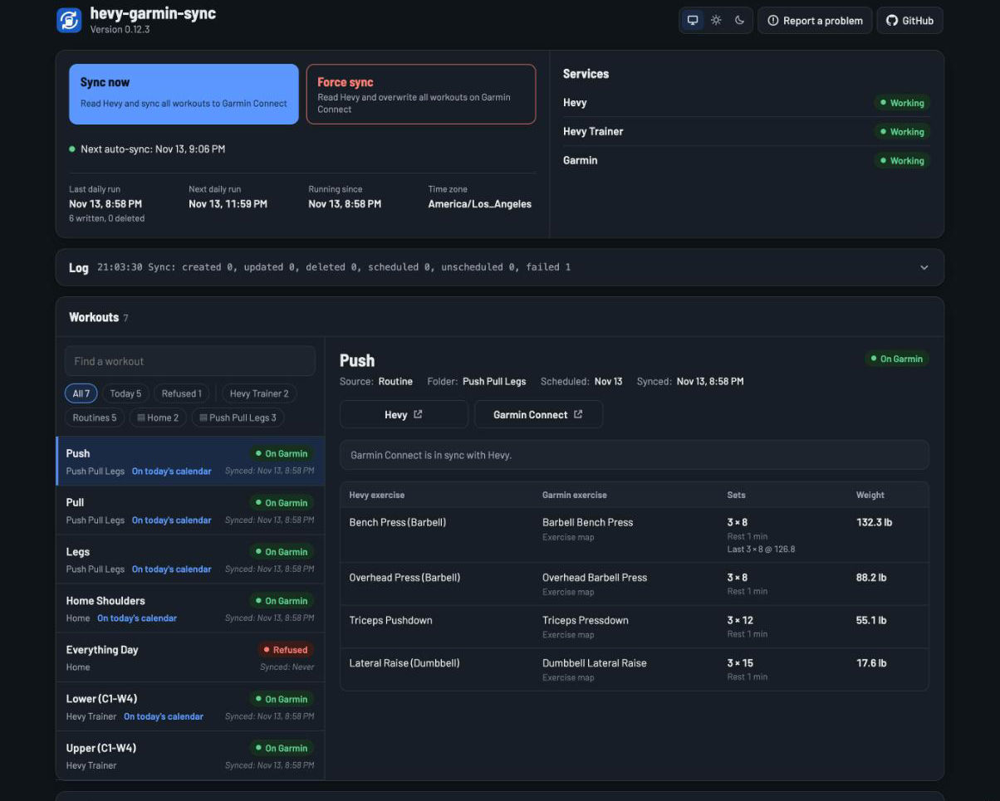

# hevy-garmin-sync


## Summary

I use Hevy to plan my strength training workouts and use my Garmin Fenix smartwatch to record them. However, Hevy lacks the ability to create custom Garmin workouts which means two things:

1. My watch attempts (and mostly fails) to detect the exercises I'm doing based on my movements which results in junk data. 
2. My Strava activities originate from either Hevy and lack the biometrics my watch collects or from Garmin Connect and lack accurate workout details.

Hevy Garmin Sync lets you to sync your Hevy routines to your Garmin smartwatch as strength workouts. That way your Garmin Connect history has accurate workout information and your (if relevant) uploaded Strava activities contain the information that originates from both platforms. 



<hr>

## How It Works

Every minute your routines are read from Hevy and, when something changes, they are automatically updated in Garmin Connect and available on your watch the next time it syncs. 

### Routines and folders

By default, each Hevy routine becomes a workout that is named after the one in Hevy. For example - `Hevy: Full Body` for a routine without a folder and `Hevy/Push Pull Legs: Push` for one in a folder. A routine you delete in Hevy is also then automatically removed from Garmin Connect. Since Hevy lacks scheduling capabilities, each routine is also added to the current day's Garmin calendar. This enables the watch to offer them to you automatically when you start a strength activity. You can choose to sync all folders, a subset of them, and to keep them off the calendar ([Configuration](#configuration)). 

### Hevy Trainer

If you Hevy Trainer every workout in your program will also get synced to Garmin Connect. For example - `Hevy/Trainer: Upper (C2-W2)` where `C2` represents the cycle you're on and `W2` equals the week. Only the workout you are planned to do next gets added to your calendar. Whenever that changes in Hevy, like when you finish one or reorder them, the calendar updates accordingly. The others still remain available as non-scheduled workouts on your watch.

### The notes screen

Each workout also includes a note for each set that includes the type of set, target reps, weight, and (if different) the name that Hevy uses for the exercise.

<hr>

## Requirements

- [Hevy Pro](https://help.hevyapp.com/hc/en-us/articles/35119778922263-Hevy-Pro-Subscription-How-to-get-Pro-and-What-Does-It-Include) to enable API access (and support the developers!)
- A Garmin watch that supports strength workouts.
- A way to run Hevy Garmin Sync (Docker, Kubernetes, Linux, etc)

<hr>

## Instructions

### 1. Authenticate with Hevy & Garmin

Create and save an API Key from Hevy at https://hevy.com/settings?developer. That's your `HEVY_API_KEY`.

Afterwards, authenticate to Garmin:

```sh
VERSION=x.y.z # https://github.com/zimmertr/hevy-garmin-sync/releases
docker run --rm -it "ghcr.io/zimmertr/hevy-garmin-sync:$VERSION" login
```

`login` will ask for your Garmin email, password and 2FA code and print a long string. That's your `GARMIN_TOKEN`. This token is only used once. Afterwards, the app will keep it refreshed and stored in its data folder, so you only need to do this again if Garmin signs you out.

### 2. Run Hevy Garmin Sync

**Docker Compose**

In `.env`, set `HEVY_GARMIN_SYNC_VERSION` to the newest [release](https://github.com/zimmertr/hevy-garmin-sync/releases), fill in the two values, and start it:

```sh
docker compose up -d
```

**Helm**

Put the two values in a Secret, and the rest in a values file:

```sh
kubectl create secret generic hevy-garmin-sync \
  --from-literal=HEVY_API_KEY=your-key \
  --from-literal=GARMIN_TOKEN=your-token
```

```yaml
# values.yaml
existingSecret: hevy-garmin-sync
env:
  TZ: America/Los_Angeles
persistence:
  size: 64Mi
```

And then install the Helm chart:

```sh
helm install hevy-garmin-sync oci://ghcr.io/zimmertr/hevy-garmin-sync-helm -f values.yaml
```

With no `--version`, Helm installs the newest release. [docs/CONFIGURATION.md](docs/CONFIGURATION.md#chart-values) has every chart value.

Only run one replica to avoid conflicts and persist the data volume since it holds your authentication tokens.

### 3. Validate the Install

After initlization, the app should sync immediatly. To validate, run`docker compose logs -f`, or `kubectl logs -f deploy/hevy-garmin-sync`. Within about a minute you should see each of your routine folders and a summary of the first sync:

```bash
INFO hevy_garmin_sync.routines Hevy routine folder: id 42, title 'Push Pull Legs'
INFO hevy_garmin_sync.app Sync: created 6, updated 0, deleted 0, scheduled 5, unscheduled 0, failed 0
```

If everything went right, the workouts should be in Garmin Connect now. Sync your watch with your phone, start a strength activity, and your routines should be there as Workouts. 

### 4. The status page

The app hosts a small web application over HTTP/8080. It shows all of the workouts it finds, their sync status in Garmin, how the exercises mapped together, each exercise's sets/reps/weights, whether Hevy and Garmin are accessible, a rolling log, the app configuration, etc. It also exposes two buttons:

* **Sync now** read Hevy and sync all workouts to Garmin Connect, and sends them all to the watch again. 
* **Force sync** The same as `Sync Now`, but it also also overwrites every workout on Garmin Connect. So if you manually edited anything there it gets overwritten for you. 

Each sync uses ~3 Garmin calls **per workout**, and Garmin does rate limit accounts that call too often. So avoid spamming these functions or you account might get locked out.

<hr>

## Configuration

A collection of envronment variables are available that can configure how the tool works.

| Variable | Default | Required | Description |
|---|---|---|---|
| `HEVY_API_KEY` | | Yes | Your Hevy API key |
| `GARMIN_TOKEN` | | Yes | Your Garmin auth token. Only needed on first init |
| `INCLUDE_HEVY_FOLDERS` | every routine | | Only these routine folders, by id or title, comma-separated |
| `CUSTOM_EXERCISE_MAP` | by muscle group | | The Garmin exercise for your own Hevy exercises, as `title-or-id=CATEGORY/NAME`, comma-separated |
| `ENABLE_SCHEDULED_WORKOUTS` | `true` | | Put every routine, and Hevy Trainer's next workout, on today's Garmin calendar |
| `ENABLE_PREVIOUS_VALUES` | `true` | | Show last time's sets for each exercise on the status page |
| `HEVY_SESSION` | off | | Turns Hevy Trainer on |
| `HEVY_POLL_INTERVAL_SECONDS` | `60` | | How often Hevy is checked |
| `TZ` | your Garmin profile's time zone | | Decides when "today" starts |
| `DATA_DIR` | `/data` | | Where the tokens are kept |
| `LOG_LEVEL` | `INFO` | | `DEBUG` for more |
| `LOG_FORMAT` | `text` | | Or `json` |
| `HTTP_PORT` | `8080` | | The status page's port |
| `PREVIEW_PR` | off | | Runs on made-up workouts for a pull request's preview, and ignores your keys |
| `PREVIEW_COMMIT` | none | | The commit a preview's banner shows |

### Only some folders

By default, every routine you have in Hevy gets synced. If you only want some of them, set `INCLUDE_HEVY_FOLDERS` to a comma-separated list of folder names or ids. The app logs every folder it finds, along with its id, when it starts up:

```
Hevy routine folder: id 42, title 'Push Pull Legs'
Hevy routine folder: id 43, title 'Home'
```

For example - this syncs both of those folders, one by name and one by id:

```sh
INCLUDE_HEVY_FOLDERS=Push Pull Legs,43
```

Keep in mind that once this is set, routines that aren't in a folder get skipped too.

### Keep it off the calendar

By default, every routine (and your next Hevy Trainer workout) gets added to today's Garmin calendar so your watch offers them to you when you start a strength activity. If you'd rather keep your calendar clean, turn it off:

```sh
ENABLE_SCHEDULED_WORKOUTS=false
```

The workouts are still available on your watch under Workouts, and any calendar entries the app already made get removed.

### Your time zone

The app decides when "today" starts based on the time zone in your Garmin profile. That matters for the calendar and for Hevy Trainer's week. If you want to override it, set `TZ`:

```sh
TZ=America/Los_Angeles
```

### Your own exercises

If you created your own exercises in Hevy, the app picks the closest Garmin exercise for each one based on the muscle group and equipment you set in Hevy. The log tells you which one it picked:

```
Custom Hevy exercise 'My Cable Raise' (muscle group shoulders, equipment cable) is Garmin's TOTAL_BODY / TOTAL_BODY, by muscle group and equipment
```

If you don't like its pick, find a better category and name in [garmin_exercises.json](src/hevy_garmin_sync/data/garmin_exercises.json) and map it yourself. For example:

```sh
CUSTOM_EXERCISE_MAP=My Cable Raise=LATERAL_RAISE/CABLE_FRONT_RAISE
```

### Hevy Trainer

Hevy doesn't expose Hevy Trainer in its public API, so your API key can't see it. Instead, the app reads it from the private API that the Hevy app itself uses. Hevy doesn't document that API and could change it at any time, and Hevy's terms allow them to suspend accounts for unauthorized use. So it's off by default.

To turn it on:

1. Open a private browser window and sign in at hevy.com.
2. Open developer tools, go to Application, then Cookies, and copy the value of the `auth2.0-token` cookie.
3. Close the window without logging out.
4. Set `HEVY_SESSION` to that value.

Don't keep using a browser that's signed in with that same session, or the app and the browser will keep ending each other's session. The Hevy app on your phone isn't affected.

<hr>

## Docs

Additional documentation is available in [`./docs/`](docs/).

| Doc | What's in it |
|---|---|
| [docs/SPEC.md](docs/SPEC.md) | The design, requirement by requirement |
| [docs/ARCHITECTURE.md](docs/ARCHITECTURE.md) | How the code, the image and the chart fit together |
| [docs/CONFIGURATION.md](docs/CONFIGURATION.md) | Every setting |
| [docs/USAGE.md](docs/USAGE.md) | What you'll see, and what to do when it breaks |
| [docs/DATA.md](docs/DATA.md) | What Hevy and Garmin return, and their quirks |
| [docs/HEVY_TRAINER_RULES.md](docs/HEVY_TRAINER_RULES.md) | How Hevy Trainer's weights are worked out |
| [docs/CICD.md](docs/CICD.md) | How a change becomes a release |
| [docs/DEVELOPMENT.md](docs/DEVELOPMENT.md) | Working on the code |

<hr>

## Known Limitations and Problems

- **Permanent vs Temporary Exercise Replacement** - Hevy allows you to swap exercises out in a Workout permanently or for a single workout. When you choose permanently, Hevy will remember and this change will beecome available on workouts that sync to your watch. However, if you choose temporarily, this information is not updated server-side. Therefore, there is no way for this tool to know about that change and it will not be synced. 
- **Inconsistent exercise names & availability** - Hevy, Garmin, and Strava all maintain their own exercise lists and names. So this tool maintains a [CSV file](src/hevy_garmin_sync/data/exercise_map.csv) that makes an attempt at correlating them between platforms. If an exercise shows up under the wrong name on the watch, feel free to raise an [issue](https://github.com/zimmertr/hevy-garmin-sync/issues/new?template=exercise-match.yml) or a PR. Additionally, if you create a custom exercise in Hevy it won't be in the platform mapping. So it will show as the closest exercise Garmin could identify based on the muscle groups and equipment set in Hevy. For example, an exercise targeting biceps that used dumbells would be detected as Dumbbell Biceps Curl. However, you can [provide your own custom exercise map via env var](#your-own-exercises) with `CUSTOM_EXERCISE_MAP`.
- **Trainer Weight Progression Syncing** - Hevy Trainer does not store weight progression server-side. It is calculated on your phone based on whether or not you met the last sessions weight and rep goals. Therefore, like temporary exercise replacements, it is not available for Hevy Garmin Sync. The app makes an effort and keeping this information up to date for you, but it can drift as Hevy changes the underlying algorithm. ([docs/HEVY_TRAINER_RULES.md](docs/HEVY_TRAINER_RULES.md)).
- **A deleted routine stays on the watch.** It leaves Garmin Connect, but the copy in the watch's saved workouts stays until you delete it on the watch.
- **Hevy to Garmin, and only planned workouts** - This app is only meant to sync your routines from Hevy to Garmin as planned workouts. Copying finished workouts between the two is intentionally out of scope. So a workout you log in Hevy doesn't become a Garmin activity, and an activity you record on your watch doesn't get sent back to Hevy. It also doesn't decide which routine you should do next. Every routine goes on today's calendar, except with Hevy Trainer, where only the workout Hevy says is next gets added.

<hr>

## Support

Open an issue. Security problems go through private reporting instead ([the security policy](https://github.com/zimmertr/hevy-garmin-sync/security/policy)).

<hr>

## License

[MIT](LICENSE). The exercise map started from [hevy2garmin](https://github.com/drkostas/hevy2garmin)'s, and Garmin is reached through [python-garminconnect](https://github.com/cyberjunky/python-garminconnect). [NOTICES.md](NOTICES.md) credits everything it builds on.
