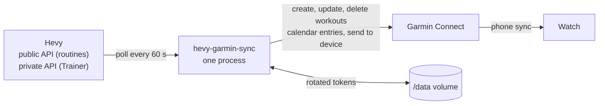

# Architecture

What is in the repo today, and where the spec puts what comes next. The behaviour itself is specified in [SPEC.md](SPEC.md); this page says where it lives.

## The repo

| Path | Holds |
|---|---|
| `src/hevy_garmin_sync/` | The Python package. Today only the command line (`cli.py`), which reports its version. #1 adds the sync |
| `tests/` | `unittest` suites, including the lock and notices checks |
| `charts/hevy-garmin-sync-helm/` | The Helm chart: one Deployment, its PersistentVolumeClaim and Secret |
| `Dockerfile` | The image: `python:3.14-slim`, the hashed lock, the package, `/data`, user 1000 |
| `.github/workflows/` | Callers of zimmertr/yggdrasil's modules, plus the chart's release jobs ([CICD.md](CICD.md)) |
| `docs/` | This set. [SPEC.md](SPEC.md) is the plan |

## The process

One long-running process (spec F-1): it validates its configuration, loads its tokens from `/data`, runs a full sync, then polls Hevy and reconciles Garmin at local midnight. Nothing listens on a port (F-2). Today the image only prints its version and exits.

## The image

Built by the release for `linux/amd64` and `linux/arm64`, tagged with the version only, at `docker.io/zimmertr/hevy-garmin-sync` (record [0003](architectural-decision-records/0003-docker-hub-until-yggdrasil-has-ghcr.md)). It runs as uid and gid 1000, and the only folder it writes is `/data` (`DATA_DIR`, spec C-8). The entry point is `python3 -m hevy_garmin_sync`.

## The chart

`hevy-garmin-sync-helm`, published with every release to `oci://registry-1.docker.io/zimmertr` under the same version as the image, whose tag it defaults to. One replica with the `Recreate` strategy, so two copies never run at once and fight over the rotating Garmin token (spec D-4). No probes: logs are the only signal (O-2). Values are in [CONFIGURATION.md](CONFIGURATION.md#chart-values).

## Where it runs for TJ

Kubernetes-Manifests `misc/hevy-garmin-sync.disabled` holds the chart version each release bumps. The misc ApplicationSet skips `*.disable*` folders, so nothing deploys until TJ's cutover from hevy2garmin (spec D-7, record [0004](architectural-decision-records/0004-bump-a-disabled-folder-until-cutover.md)).
