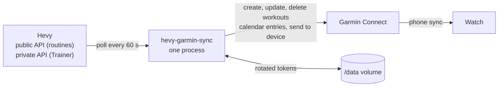

# Architecture

Where each part of the app lives. The behaviour is specified in [SPEC.md](SPEC.md); this page says which file does what.

## The repo

| Path | Holds |
|---|---|
| `src/hevy_garmin_sync/` | The Python package ([the modules](#the-modules)) |
| `src/hevy_garmin_sync/data/` | The two exercise tables the app ships ([the exercise map](#the-exercise-map)) |
| `tests/` | `unittest` suites, one fixtures module with every fake, and Garmin's exercise list for the data test |
| `charts/hevy-garmin-sync-helm/` | The Helm chart: one Deployment, its PersistentVolumeClaim and Secret |
| `compose.yaml` | The same container for Docker Compose |
| `Dockerfile` | The image: `python:3.14-slim`, the hashed lock, the package, `/data`, user 1000 |
| `.github/workflows/` | Callers of zimmertr/yggdrasil's modules, plus the chart's release jobs ([CICD.md](CICD.md)) |
| `docs/` | This set. [SPEC.md](SPEC.md) is the plan |

## The process

One long-running process and one thread (spec F-1). Nothing listens on a port (F-2).

1. **Start.** Read the environment. Anything wrong exits with a message naming the variable. Load the Garmin token, and the Hevy session if `HEVY_SESSION` is set, from `DATA_DIR`, seeding each from its variable when the variable is new (A-4).
2. **Check.** One call to each service. A rejected key, token or session exits with the fix. An outage is waited out.
3. **Full run.** Read every routine (and the Trainer program), read Garmin's workout list and the calendar, then create, update and delete until Garmin matches. Put each workout on today.
4. **Poll.** Every `HEVY_POLL_INTERVAL_SECONDS`, read Hevy again. Garmin is called only for what changed (F-4a).
5. **Midnight.** At local midnight, a full run again: yesterday's calendar entries go and today's are added.
6. **Stop.** SIGTERM or SIGINT lets the write in progress finish and starts no new one.

A failing service gets its own wait, one minute doubling to thirty (O-1). Hevy's public API, Hevy's private API and Garmin each have one, so routines keep syncing while only Trainer is down, and Hevy is still read while Garmin is down.

## The modules

| Module | Does |
|---|---|
| `cli.py` | The command line: no command runs the app, `login` signs in to Garmin |
| `app.py` | The loop: startup checks, polling, midnight, the waits after a failure, stopping |
| `config.py` | Reads and checks the environment variables |
| `logs.py` | Text or JSON log lines |
| `store.py` | The data folder: whole-file writes that survive a kill, and which variable a stored token came from |
| `hevy.py` | Hevy's public API: folders, routines, exercise templates, workout events, exercise history |
| `hevy_private.py` | Hevy's private API, for Trainer only: the session and its refresh, the program, the preferences, the logged workouts |
| `routines.py` | Which routines sync, what each is called, and each routine as a planned workout |
| `trainer.py` | Trainer's program as planned workouts, and what is read when |
| `trainer_rules.py` | Trainer's arithmetic: the week, the next weight, warm-ups, rep ranges ([HEVY_TRAINER_RULES.md](HEVY_TRAINER_RULES.md)). No I/O |
| `exercises.py` | The Garmin exercise for each Hevy exercise |
| `workout.py` | A planned workout as Garmin's workout JSON, its version hash, and the description that marks it as the app's. No I/O |
| `garmin.py` | Garmin Connect through python-garminconnect: workouts, the calendar, Send to Device, saving the rotated token |
| `sync.py` | Makes Garmin match the plan: what to create, update, delete, schedule and send |
| `login.py` | The `login` command: one sign-in, and the value for `GARMIN_TOKEN` on stdout |

`routines.py` and `trainer.py` each return a `Plans`: the workouts one source wants in Garmin. `sync.py` takes both and knows nothing about Hevy.

## How a workout is recognised

The app keeps no database. Each Garmin workout it makes carries four lines in its description: a first line that marks it as the app's, when it was last updated, the Hevy routine id or Trainer template id, and a six-character version hash of its contents (F-12). At a full run the app reads Garmin's workout list and matches on those. A workout without them is never touched. A workout is rewritten only when its version hash changes.

## The exercise map

Two CSV files in `src/hevy_garmin_sync/data/`:

- `exercise_map.csv`: one row per built-in Hevy exercise, by Hevy's exercise template id, naming a Garmin category and exercise.
- `custom_exercise_map.csv`: for a user's own exercises, and for a built-in the first table has no row for, by Hevy's primary muscle group and equipment.

`tests/data/garmin_exercises.json` holds the keys of Garmin Connect's own exercise list, and a test fails when a row names a pair that is not in it (F-51). A fix is a one-line PR (F-54).

## The image

Built by the release for `linux/amd64` and `linux/arm64`, tagged with the version only, at `ghcr.io/zimmertr/hevy-garmin-sync` (record [0006](architectural-decision-records/0006-ghcr-and-a-digest-pinned-chart.md)). It runs as uid and gid 1000, and the only folder it writes is `/data` (`DATA_DIR`, spec C-8). The entry point is `python3 -m hevy_garmin_sync`.

## The chart

`hevy-garmin-sync-helm`, published with every release to `oci://ghcr.io/zimmertr` under the same version as the image, whose digest it pins (record 0006). One replica with the `Recreate` strategy, so two copies never run at once and fight over the rotating Garmin token (spec D-4). No probes: logs are the only signal (O-2). Values are in [CONFIGURATION.md](CONFIGURATION.md#chart-values).

## Where it runs for TJ

Kubernetes-Manifests `misc/hevy-garmin-sync` holds the chart version each release bumps, the values (the hand-made Secret and the volume's storage class) and the namespace. The misc ApplicationSet deploys it, so the bump PR is the deploy (spec D-7, record [0005](architectural-decision-records/0005-releases-deploy-through-the-live-folder.md)). It replaced hevy2garmin and hevy-trainer-sync on 2026-11-10.
