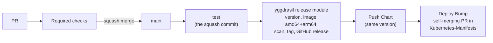

# CI/CD

How a change gets from a PR to a release. Every workflow calls a zimmertr/yggdrasil module where one exists (record [0002](architectural-decision-records/0002-ci-on-yggdrasil-modules.md)); Renovate moves the module pins as soon as yggdrasil releases.

## PR checks

| Workflow | Check | What it does |
|---|---|---|
| `test.yml` | `test` | The suite under coverage, with the line and branch table in the run summary |
| `pr.yml` | `Python Lint` | ruff and mypy, from the hashed dev lock |
| `pr.yml` | `Chart / Chart` | yggdrasil's chart module: `helm lint`, the chart rendered with the defaults, then this repo's renders: with an existing Secret, with a namespace, with a digest, and the read-only root filesystem |
| `pr.yml` | `Docker Build / Docker Build` | yggdrasil's docker-build module: hadolint, the amd64 image built, a Trivy table in a sticky comment, the smoke test, and a failure on any fixable Critical or High |
| `lint.yml` | `Lint / actionlint`, `Lint / zizmor`, `Lint / semgrep` | yggdrasil's lint module over the workflows and the Dockerfile |
| `pr-title.yml` | `PR Title / PR Title` | yggdrasil's pr-title module: the title must be `type(scope): summary` |

The default-branch ruleset requires every check above. Renaming or adding a check needs a PR in zimmertr/yggdrasil that changes this repo's `required_checks`, merged together with the rename; otherwise PRs wait forever on the old name.

## The release

Every merge to main is a release (`release.yml`), one at a time. After the test, every step is a job of yggdrasil's release module (record [0012](architectural-decision-records/0012-the-chart-goes-through-yggdrasils-modules.md)):

1. `test` runs again on the squash commit.
2. The module reads the version from the squash commit's title with GitVersion (`feat` a minor, `!` a major, anything else a patch; the first release is 0.1.0), builds and pushes `ghcr.io/zimmertr/hevy-garmin-sync:<version>` for amd64 and arm64 with an SBOM and provenance, scans each platform with Trivy, then tags `v<version>` and publishes the GitHub release. A fixable Critical or High stops the tag and release.
3. `Release / Push Chart (charts/hevy-garmin-sync-helm)` writes the image's digest into `values.yaml`, packages the chart with that version as both `version` and `appVersion`, and pushes it to `oci://ghcr.io/zimmertr`. A version already there is skipped. Record: [0006](architectural-decision-records/0006-ghcr-and-a-digest-pinned-chart.md)
4. `Release / Deploy Bump (zimmertr/Kubernetes-Manifests)` sets the chart version in `misc/hevy-garmin-sync/kustomization.yml` through a PR on the fixed branch `chore/hevy-garmin-sync-chart`, and arms auto-merge. When that PR merges, Argo CD rolls the pod to the new release.

`image-scan.yml` re-scans the latest release every Monday and sends the findings to the Security tab. Its first run fails until a release exists.

## Dependency updates

Renovate opens the update PRs, titled `chore(deps): update ...`. `.github/renovate.json` extends zimmertr/yggdrasil's shared preset, which holds the rules every repo of TJ's uses (record [0014](architectural-decision-records/0014-renovate-under-yggdrasils-preset.md)):

- A release waits seven days before Renovate proposes it. yggdrasil's own modules don't wait, and neither does anything whose registry gives no publish date.
- Everything below a major merges itself once the required checks pass, and that merge is a release. A major waits for TJ, and so does a Python minor (3.15 to 3.16), which can break code. Renovate's PR for one moves only the workflows: the `Dockerfile`, the `Makefile`'s `PYTHON_IMAGE`, `mypy.ini` and both locks move with them by hand, in one PR.

What this repo adds:

| Setting | Why |
|---|---|
| `pip-compile` reads `requirements.txt` and `requirements-dev.txt` | Renovate bumps the pin in the `.in` file and recompiles every lock that depends on it, hashes included. A pin in `requirements.in` moves both locks in one PR |
| `pip-compile`'s `lockFileMaintenance` is off | On by default for this manager, it opens a "Refresh pip-compile outputs" PR that recompiles both locks to move every indirect pin to its newest release, with no seven-day wait. An indirect pin moves when a direct pin's update needs it, or by hand |
| `pip_requirements` is off | It would bump a lock's pin without recompiling its hashes |
| `ghcr.io/zimmertr/hevy-garmin-sync` is off | `compose.yaml` runs this repo's own image. A bump would merge, release a new version and be proposed again |

Renovate recompiles a lock with the command in its header, so the header must hold only options Renovate knows. pip-tools 7.5.3 wrote `--no-index` there, which Renovate refuses; `make lock` pins 7.6.2, which doesn't.

## The upstream check

`upstream-check.yml` runs every Monday and can be started by hand. It is not a required check, and no yggdrasil module covers it, so it lives here. It runs `scripts/check_upstream.py`, which reads two public files with no sign-in and compares them with their copies in the repo:

| Source | Copy | Keeps |
|---|---|---|
| Garmin's exercise list, `https://connect.garmin.com/web-data/exercises/Exercises.json` | `src/hevy_garmin_sync/data/garmin_exercises.json`, in the package because the app checks `CUSTOM_EXERCISE_MAP` against it | Each category key with its exercise keys (spec F-51, C-11) |
| Hevy's API spec, inside `https://api.hevyapp.com/docs/swagger-ui-init.js` | `tests/data/hevy_api.json` | Each path with its methods, and the exercise type, equipment, muscle group and set type enums |

1. `Compare` runs the script. The same copies pass and open nothing. A source it can't fetch or read fails the run.
2. On a difference, `Issue` opens an issue titled "Garmin's exercise list or Hevy's API changed", labelled `P2`, `enhancement` and `ci`, with what was added and removed. While that issue is open, a later run comments on it instead of opening another.
3. `PR` reads the sources again, rewrites the copies and opens a PR from the fixed branch `chore/upstream-copies`, or force-pushes the one already open. Its title is `test(upstream): update the copies of Garmin's exercise list and Hevy's API`, and it closes the issue. It uses `GH_PAT`, because a PR opened with `GITHUB_TOKEN` starts no workflows and its required checks would never report. When this job fails, the issue stays and the run fails.

Record: [0010](architectural-decision-records/0010-a-weekly-check-of-the-upstream-copies.md)

After a failure, re-run the failed jobs only. Never re-run an old release after a newer one shipped.

## Secrets

| Secret | Store | Used by |
|---|---|---|
| `GITHUB_TOKEN` | Given to each run | The image push and the chart push, to GHCR (`packages: write`); the upstream check's issue (`issues: write`) |
| `GH_PAT` | Actions | The Kubernetes-Manifests bump, as the release module's `deploy-token`, and the upstream check's push and PR here (contents and pull-requests write on both repos) |

## Repo settings

Since 2026-11-10 the repo's settings, rulesets and required checks are applied by Terraform from zimmertr/yggdrasil (`repos/zimmertr/hevy-garmin-sync.yml` there, plus its repo module). A setting changed by hand is put back by the next apply, so a settings change is a yggdrasil PR that TJ okays first.

Before the import, these were set by API with TJ's okay, and Terraform took them over unchanged:

| Date | Setting |
|---|---|
| 2026-11-07 | Squash merge only, title and body from the PR; auto-merge on; head branches deleted; "Update branch" on; wiki off |
| 2026-11-07 | Secret scanning and push protection; Dependabot alerts and security updates; private vulnerability reporting; immutable releases |
| 2026-11-07 | Actions must be pinned by full commit SHA; CodeQL default setup; rulesets "default branch" (PR required, 0 approvals, stale reviews dismissed, threads resolved, squash only, no force push or deletion) and "release tags" (`refs/tags/v*`: no update or deletion) |
| 2026-11-10 | The eight required checks on the "default branch" ruleset; Projects off |
